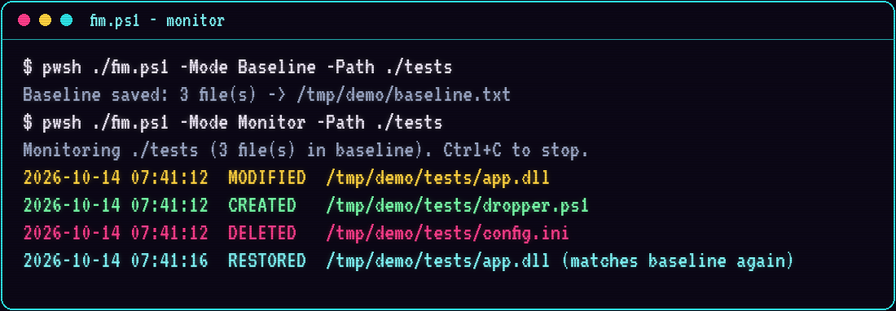
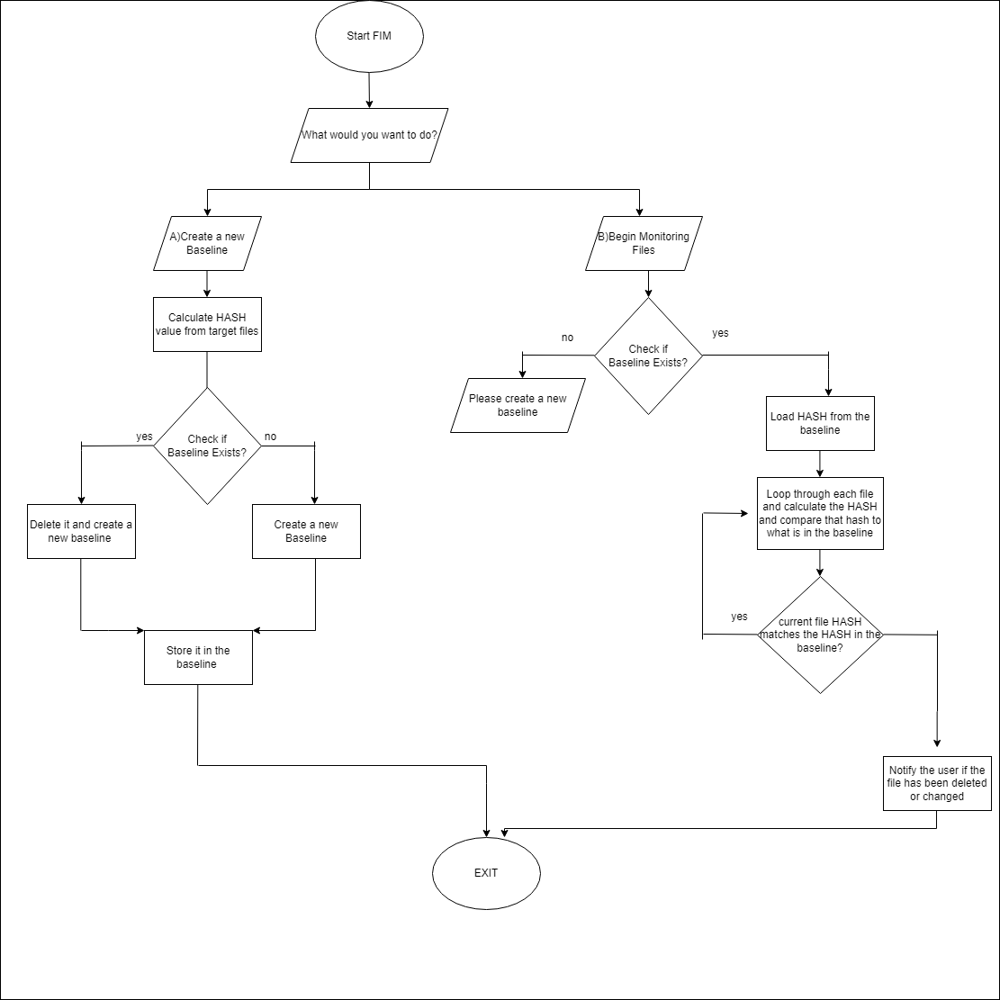

<p align="center"></p>

# FIM — File Integrity Monitor (PowerShell)

A lightweight file integrity monitor written in PowerShell. It records a **SHA-512 baseline** of a folder, then watches it and alerts the moment a file is **created, modified, deleted, or restored**. This is the same idea behind enterprise FIM in tools like Wazuh or Tripwire, stripped down so every step is visible.

<p align="center"></p>

## How it works

<p align="center"></p>

1. **Baseline:** hash every file in the target folder with SHA-512 and save `path|hash` pairs to `baseline.txt`.
2. **Monitor:** every few seconds, re-hash the folder and compare against the baseline:
   - path not in the baseline → **CREATED**
   - path in the baseline, hash differs → **MODIFIED**
   - baseline path no longer on disk → **DELETED**
   - a changed file matches its baseline hash again → **RESTORED**

Each event is reported **once**, not on every polling cycle, so a single change doesn't flood the console.

## Usage

Works on Windows PowerShell 5.1 and PowerShell 7+ (Windows, Linux, macOS).

```powershell
# Interactive menu (A = baseline, B = monitor) against ./tests
./fim.ps1

# Baseline a folder
./fim.ps1 -Mode Baseline -Path C:\Important\Config

# Monitor it, including sub-folders, polling every 2 s, writing alerts to a log
./fim.ps1 -Mode Monitor -Path C:\Important\Config -Recurse -Interval 2 -LogFile .\fim-alerts.log
```

| Parameter       | Default            | Purpose                                     |
| --------------- | ------------------ | ------------------------------------------- |
| `-Mode`         | menu               | `Baseline` or `Monitor`                     |
| `-Path`         | `./tests`          | Folder to protect                           |
| `-BaselineFile` | `./baseline.txt`   | Where hashes are stored                     |
| `-Interval`     | `1`                | Seconds between scans                       |
| `-Recurse`      | off                | Include sub-folders                         |
| `-LogFile`      | none               | Also append alerts to this file             |

If Windows blocks the script, allow it for the current session with `Set-ExecutionPolicy -Scope Process Bypass`.

## Try it

```powershell
./fim.ps1 -Mode Baseline
./fim.ps1 -Mode Monitor
# in a second terminal:
Add-Content ./tests/report.txt "tampered"   # MODIFIED
New-Item ./tests/dropper.ps1                 # CREATED
Remove-Item ./tests/config.ini               # DELETED
```

## Security notes and limitations

- **Protect the baseline.** An attacker who can edit `baseline.txt` can hide their changes. In real use, store the baseline somewhere the monitored host can't write to, or sign it.
- **Polling, not real-time.** Changes made and reverted between two scans are missed. Production FIM hooks file-system events (e.g. `FileSystemWatcher`, auditd, Sysmon event ID 11).
- **Content only.** Permission, owner, and timestamp changes that don't alter file contents aren't detected.

## Changelog

**v2**
- Parameters replace the hard-coded `C:\Users\user\Desktop\FIM\tests` path.
- Fixed a PowerShell 7 bug: `"a||b".Split("||")` returns 2 parts in PS 7 but 3 in PS 5.1, so the old parser read a `$null` hash and reported *every* file as changed. The baseline is now parsed on the last separator.
- Each alert fires once instead of every second.
- Added RESTORED events, sub-folder support, and log-file output.
- Directories are skipped instead of throwing hashing errors.
- The baseline is saved as UTF-8.

## License

[MIT](LICENSE)
